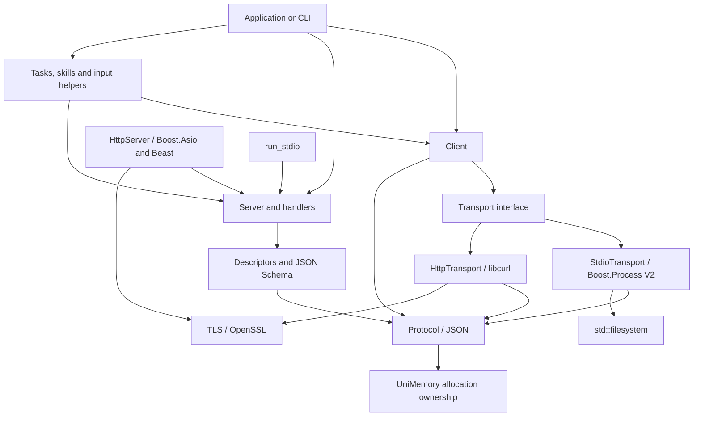

# Architecture

MCP separates the wire protocol, transports and application handlers. It does not depend on an agent runtime, model provider, business memory store or GUI.



Arrows show use, not separate binary dependencies. The package installs one library, `MCP::MCP`; individual headers allow selective inclusion. Optional feature classes do not require applications to use tasks, authentication or the CLI.

## Responsibilities

| Component | Responsibility | Application responsibility |
| --- | --- | --- |
| `protocol`, `json` | Wire envelopes, identifiers, bounded parsing, errors | Choose limits appropriate to the deployment |
| `schema`, descriptors | Declare interfaces and validate supported schemas | Define meaningful schemas and business rules |
| `Server` | Register and dispatch tools/resources/prompts/extensions | Implement handlers and authorize operations |
| `Client` | Discovery, pagination, request correlation and results | Decide what operations are trusted and useful |
| `StdioTransport` | Launch a child, exchange messages, clean up its process tree | Choose executable, arguments and environment |
| `HttpTransport`, `HttpServer` | HTTP/SSE, TLS, connection management | Identity policy, certificates and exposure |
| `auth` | OAuth/resource authorization building blocks | Token verification, secure storage, consent policy |
| `features`, `extensions` | Input workflows, task records and skill helpers | Execute work and provide durable storage if needed |

Public calls are synchronous. Transport internals manage asynchronous I/O; request limits and timeouts control resource use. User callbacks must remain bounded because C++ cannot safely preempt arbitrary callback code.

## Dependencies

| Dependency | Role |
| --- | --- |
| UniMemory | JSON allocation resource and lifetime ownership |
| nlohmann/json | Public allocator-aware `mcp::Json` representation |
| jsoncons | JSON Schema validation |
| Boost.Asio / Beast | Server networking and HTTP/SSE processing |
| Boost.Process V2 | Cross-platform subprocess and pipe integration |
| libcurl | HTTP client and TLS transport |
| OpenSSL | TLS support |
| GoogleTest | Tests only |

Boost.Process is compiled with `BOOST_PROCESS_USE_STD_FS=ON`. The local vcpkg overlay retains the official implementation and excludes the inactive Boost.Filesystem dependency. See [overlay details](https://github.com/dugan-dev/MCP/blob/main/ports/boost-process/README.md).

## Repository layout

```text
MCP/
├── include/mcp/           Public interface; all.h is the umbrella header
├── src/                   Private implementation
├── cli/                   mcp command-line application
├── examples/              Complete stdio and HTTP applications
├── tests/                 Unit, transport, stress, interop and package tests
├── benchmarks/            Informational measurements; separate from CTest
├── tools/                 Repository metadata, documentation and formatting checks
├── cmake/                 Dependency, export and runtime installation helpers
├── ports/                 Boost.Process std::filesystem build profile
├── external/unimemory/    Pinned official fallback source and license
├── docs/                  User guides and source attribution
├── licenses/              Retained third-party terms
└── .github/               Cross-platform CI and contribution templates
```

Generated builds and downloaded SDKs stay under ignored `build/`. Review reports and exploratory data are not release sources.

Internal PMR aliases live in `src/containers.h`; they do not change the public value types or select a resource automatically. JSON owns its selected allocation resource, while ordinary containers and escaping smart-pointer control blocks retain their documented allocation/lifetime contracts. Changes to allocation policy require measurements and lifetime tests rather than a blanket type replacement.
